# Capital Crashpad: Platform Governance and Airbnb in Washington, DC


*When platforms change the rules, markets respond. This project examines how Washington, D.C.'s Airbnb market changed following Airbnb's 2024 verification expansion — in size, composition, and revenue distribution.*

🔗 [Data Story & Dashboard](https://johbry17.github.io/Capital-Crashpad/)  
🔗 [Case Study](https://johbry17.github.io/Capital-Crashpad/case_study.html)
<!-- 🔗 [Tableau Dashboard](https://public.tableau.com/app/profile/bryan.johns6699/viz/DC-Airbnb/DCAirbnbMobile)   -->

> ℹ️ **Status:** The dashboard is updated as new quarterly data becomes available. The accompanying case study is intentionally frozen at 2025 Q3 to preserve a consistent before-and-after analysis of Airbnb's 2024 verification expansion. Legacy full-stack versions (Flask and Django) are archived in the `/legacy` folder.

## Table of Contents

- [Project Overview](#project-overview)
- [Key Findings](#key-findings)
- [Research Design](#research-design)
- [Data & Methodology](#data--methodology)
- [Interpretation & Limitations](#interpretation--limitations)
- [Dashboard & Case Study](#dashboard--case-study)
- [Technical Implementation](#technical-implementation)
- [Gallery](#gallery)
- [References](#references)
- [License](#license)
- [Acknowledgements](#acknowledgements)
- [Author](#author)

## Project Overview

Capital Crashpad analyzes a structural break in Washington, D.C.'s Airbnb market.

In Q2 2024, after Airbnb expanded listing verification requirements and quality standards, roughly 1,800 listings disappeared from the platform in a single quarter. This project investigates what changed — not just how many listings left, but which ones, and what the market looked like afterward.

The analysis combines:

- An interactive public-facing dashboard (GitHub Pages)
- A structured narrative case study (nbconverted HTML)
- A PostgreSQL-backed ETL pipeline
- Multi-quarter panel analysis in Python

Key questions explored:

- Did the market simply shrink — or reorganize?
- Were unlicensed listings disproportionately removed?
- What happened to extended-stay (31+ minimum night) rentals?
- Did revenue per listing decline because low-performers exited — or high earners?
- Did enforcement reduce concentration among top hosts?

The findings suggest the contraction was not random. Listings configured with 31+ night minimum stays — above D.C.'s 30-night regulatory threshold — declined sharply, accounting for roughly two-thirds of the total loss. The platform became smaller, more licensed, and more oriented toward short-term stays. Revenue concentration, however, remained unchanged.

This project sits at the intersection of housing policy, platform governance, and data storytelling.

## Key Findings

All findings are based on Inside Airbnb quarterly scrape data and reflect observable (publicly listed) Airbnb activity in Washington, D.C.

- **Sharp contraction in Q2 2024.** Active D.C. listings dropped from approximately 6,700 in Q1 2024 to roughly 4,900 in Q2 2024 — a decline of about 1,800 listings (~26%) in a single quarter. The timing aligns with Airbnb's platform-wide verification and quality enforcement, which the company reported removed over 200,000 listings nationally.

- **Extended-stay listings declined disproportionately.** About 1,200 of the ~1,800-listing decline involved listings with 31+ night minimum stays. This segment — which sits above D.C.'s 30-night regulatory threshold for short-term rentals — fell from roughly one-third of all listings to a substantially smaller share.

- **The market became more licensed.** After the contraction, the share of listings with a D.C. short-term rental license increased, as unlicensed listings declined at higher rates than licensed ones.

- **Revenue per listing declined, most sharply for extended-stay.** Projected annual revenue per listing — a proxy calculated as `nightly price × (365 − availability_365)` — fell after Q2 2024. The drop was most pronounced for 31+ night listings, whose estimated revenue had previously been comparable to shorter-term listings.

- **Revenue concentration was unchanged.** Earnings remained highly concentrated among the largest hosts before and after the contraction. The market became smaller and more licensed, but the distribution of estimated revenue did not flatten.

- **The contraction was geographically broad.** Nearly every D.C. neighborhood lost active listings in Q2 2024, with no single area absorbing a disproportionate share of the decline.

## Research Design

**Unit of analysis:** Individual listings, observed in quarterly cross-sectional snapshots from Inside Airbnb. Each scrape captures listings active on the platform at the time of collection.

**Study period:** The case study covers Q2 2023 through Q3 2025, spanning ten quarters and bracketing the Q2 2024 contraction. The interactive dashboard is updated as new quarterly data becomes available. The case study is intentionally frozen to preserve a coherent before-and-after window.

**Treatment event:** Q2 2024, when the listing count dropped sharply. This quarter aligns with Airbnb's rollout of identity verification, listing quality enforcement, and hosting standards updates announced in its 2024 Spring Update and Q1/Q2 2024 Shareholder Letters.

**Comparison structure:** The analysis compares market structure — size, license composition, revenue distribution, minimum-night configuration — before and after Q2 2024, using the full time series to distinguish the contraction from seasonal variation.

**Observational design:** This is a longitudinal observational study, not a controlled experiment. The analysis identifies associations and structural changes in the observable market. The design cannot establish causation.

## Data & Methodology

**Primary dataset:** Inside Airbnb quarterly scrape data for Washington, D.C. The pipeline covers eleven quarterly snapshots (Q2 2023 through Q2 2026), providing longitudinal coverage before, during, and after the Q2 2024 contraction.

**License classification:** Each listing's license field is grouped into three categories:
- **Licensed** — listings holding a D.C.-issued hosted or unhosted short-term rental license
- **Exempt** — listings marked exempt (e.g., hotels)
- **No License** — listings with a blank or unrecognized license field

**Revenue proxy:** Estimated annualized revenue is calculated as `nightly price × (365 − availability_365)`. This is an upper-bound proxy for potential annual booking value — it assumes every unavailable day results in a paid booking at the listed nightly rate. Results should be interpreted structurally (comparing trends and relative differences across groups) rather than as financial totals.

**"Likely commercial" classification:** A listing is flagged as likely commercial if it is an entire home or apartment, the host has two or more listings, and the listing shows more than 180 days of annual availability. This is a heuristic, not a definitive determination.

**Listing persistence:** A listing is defined as persistent if it appears in at least four quarterly snapshots (approximately one year). Absence from a snapshot does not confirm permanent removal.

**Price anomaly filtering:** Listings with extreme nightly prices (≥$6,500) in the most recent quarter are reviewed and removed to prevent distortion of summary metrics.

**Neighborhood population data:** 2020 Census Reporter data provides population and housing unit counts for per-1,000-resident density metrics.

**Database:** A PostgreSQL database stores the full longitudinal dataset. SQL views provide reusable aggregations for quarterly market summaries, neighborhood trends, host structure, and listing persistence.

## Interpretation & Limitations

**Timing is not causation.** The Q2 2024 contraction aligns closely with Airbnb's platform-wide enforcement actions, which the company publicly reported. The analysis identifies a structural break at that quarter; it does not establish that the policy caused the contraction. Other factors — seasonal effects, regulatory enforcement, or market dynamics — may also have contributed.

**"Disappeared" means absent from the scrape.** A listing not appearing in a quarterly snapshot may have been removed by the platform, voluntarily delisted, temporarily blocked, or missed due to scraping timing. The analysis cannot distinguish among these causes.

**Revenue proxy is an upper bound.** The estimated revenue metric overstates actual booking revenue. It is useful for comparing relative revenue levels and trends across groups — not for estimating total economic activity in dollar terms.

**The 31+ night threshold is suggestive, not conclusive.** The concentration of losses in listings with 31+ night minimums is consistent with regulatory arbitrage — these listings sat above D.C.'s licensing threshold for short-term rentals. The data cannot confirm why hosts configured minimum nights at that level; other explanations (medium-term rental operators, corporate housing) are also possible.

**Inside Airbnb data is scraped, not authoritative.** It captures the publicly visible market at a point in time. Listings not shown to scrapers (e.g., due to blocked calendars) may not appear in the data, and the scrape may not capture all active listings.

## Dashboard & Case Study

**Interactive Dashboard** ([Live →](https://johbry17.github.io/Capital-Crashpad/))

- Guided data-storytelling tour (Shepherd.js)
- Multi-metric neighborhood comparison with dynamic analytical questions
- Revenue concentration analysis (Lorenz and Pareto plots)
- Density vs. scale visualizations (listings per 1,000 residents)
- Choropleth maps with neighborhood-level filtering

**Case Study** ([Read →](https://johbry17.github.io/Capital-Crashpad/case_study.html))

A structured narrative frozen at Q3 2025 for archival consistency:

- Before/after structural comparison anchored to the Q2 2024 event
- Revenue segmentation by minimum-night category (< 31 nights vs. 31+ nights)
- License composition over time
- Revenue concentration (Lorenz curve), before and after
- Neighborhood-level impact with policy context

## Technical Implementation

**Pipeline:**

1. Inside Airbnb quarterly `.csv` files are organized into dated subdirectories under `resources/data/raw_data/`.
2. `notebooks/etl_2026.ipynb` loads, cleans, and normalizes the data into a PostgreSQL database (`capital-crashpad`).
3. The ETL computes derived fields (license category, likely commercial flag, hover descriptions), applies price anomaly filtering, and populates four tables and five SQL views.
4. Summary CSVs and GeoJSON are exported to `docs/static/resources/` for the dashboard.
5. `notebooks/case_study.ipynb` queries the database directly and produces publication-quality Matplotlib charts.
6. `notebooks/export_case_study.py` converts the case study notebook to HTML and injects metadata for publication as `docs/case_study.html`.

**To update the dashboard:**

```
Open: notebooks/etl_2026.ipynb
Run all cells to update quarterly tables, regenerate views, and export CSVs.
```

The case study is static — its SQL queries are scoped to Q2 2023–Q3 2025 and will not update automatically. Dashboard-only updates are straightforward; a case study update requires adjusting those time bounds and re-exporting.

**Tools:**

- **Data pipeline:** Python (Pandas, NumPy), PostgreSQL, SQLAlchemy, Jupyter Notebook
- **Analysis:** Matplotlib (case study charts), Seaborn (exploratory analysis)
- **Dashboard:** JavaScript, Chart.js, Plotly (concentration curves), Leaflet (maps), HTML/CSS, Bootstrap, GitHub Pages
- **Export:** nbconvert (case study HTML publication)

**Legacy archive:** Flask and Django full-stack implementations, earlier exploratory notebooks, and a Tableau version are preserved in `/legacy`.

## Gallery

Below are key visualizations from the dashboard and case study:

**Case Study:**
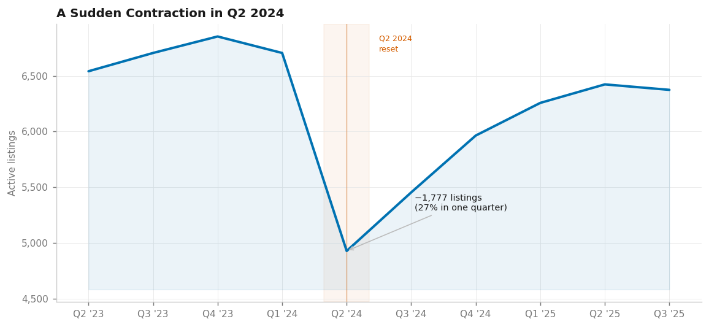  
_Sharp decline and partial rebound in Airbnb listings following Airbnb's expanded verification and quality removals._  

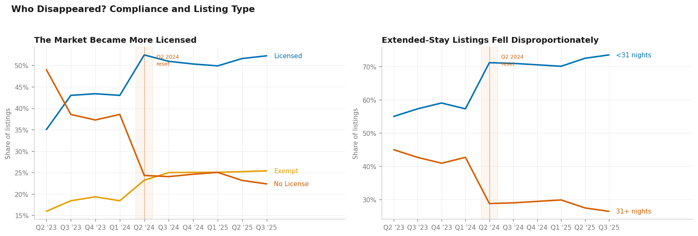  
_Increase in the share of licensed Airbnb listings following the Q2 2024 contraction._  

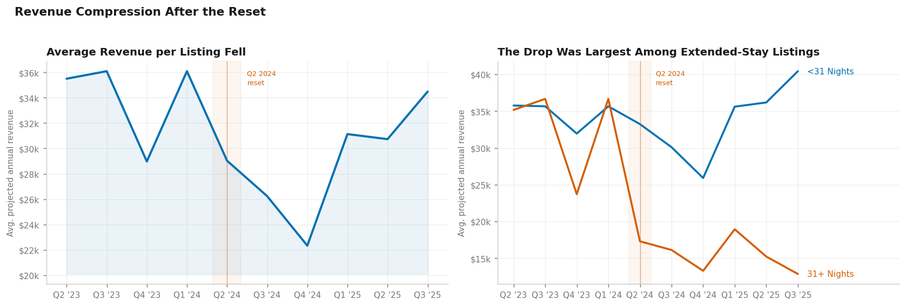  
_Projected revenue per listing declined most sharply among extended-stay listings after the Q2 2024 contraction._  

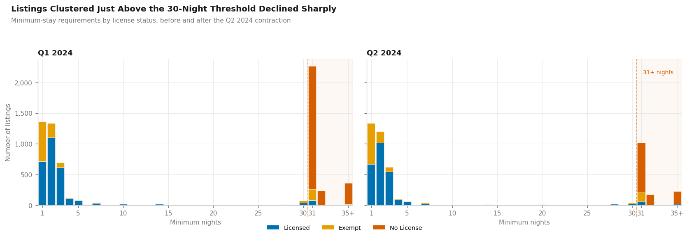  
_Unlicensed listings requiring 31+ night stays declined disproportionately during the Q2 2024 contraction._  

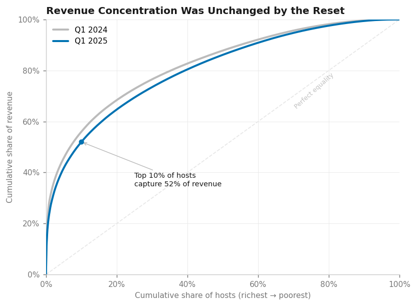  
_Revenue concentration remained highly skewed toward the largest hosts before and after the Q2 2024 contraction._  

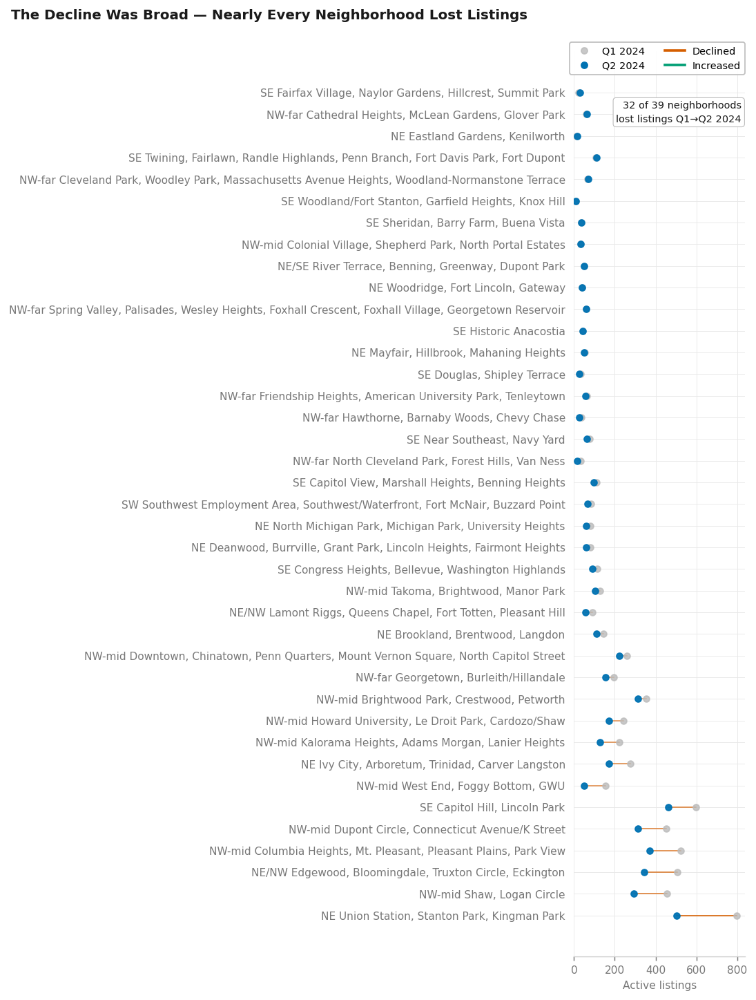  
_The Q2 2024 contraction was broad, with nearly every D.C. neighborhood losing active listings._  

**Dashboard:**
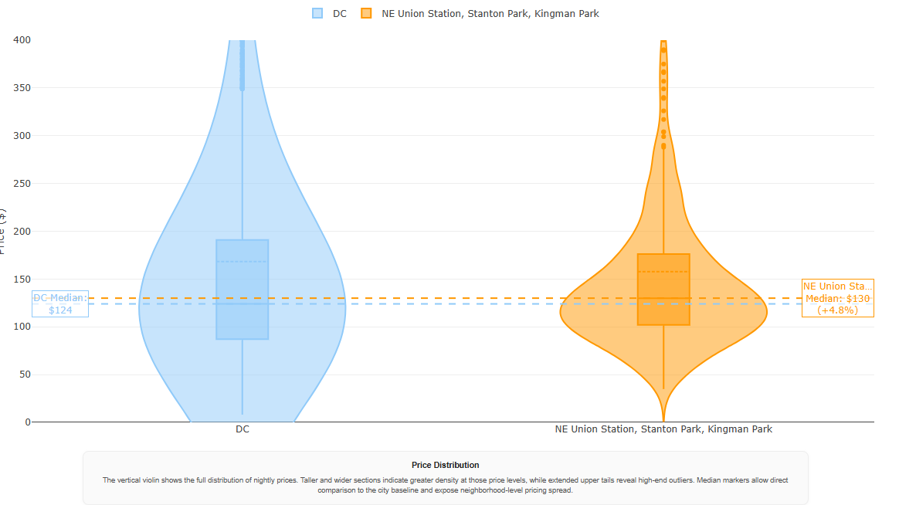  
_Distribution of nightly prices and availability for Airbnb listings, highlighting the median value._  

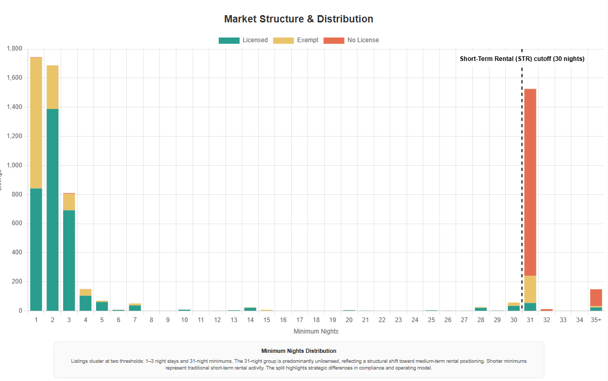  
_Minimum nights required for Airbnb listings, segmented by license status._  

**Interactive Map:**
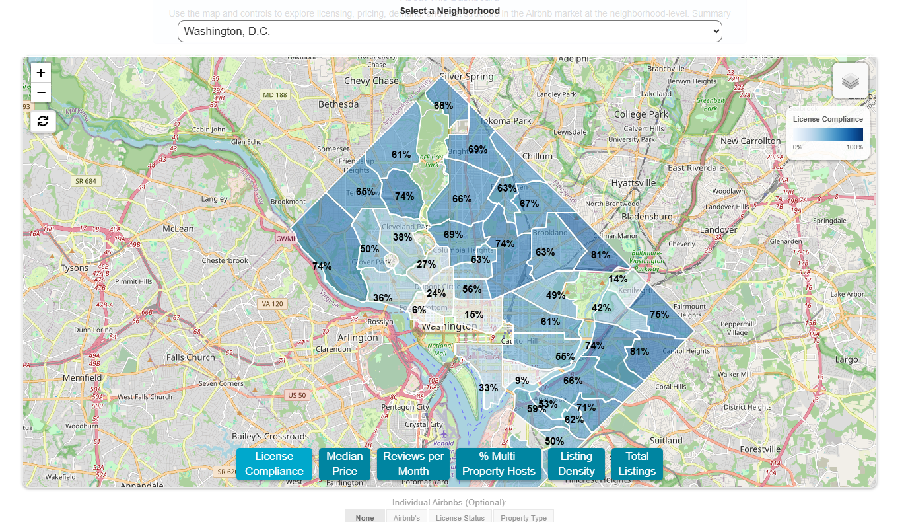  
_Percentage of licensed Airbnb listings in each neighborhood._  

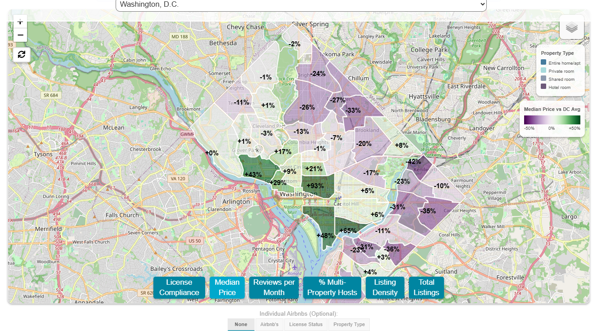  
_Median Airbnb price per neighborhood, relative to the citywide median._  

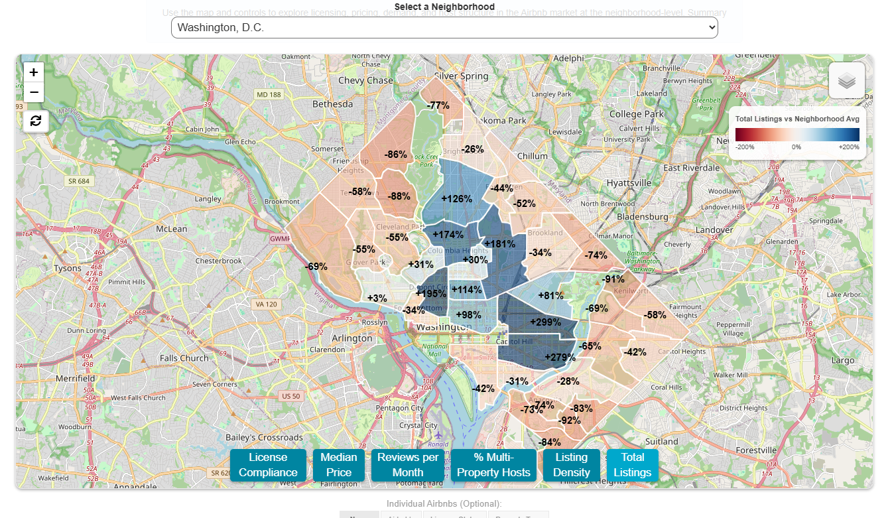  
_Total Airbnb listings by neighborhood, compared to the citywide average._  

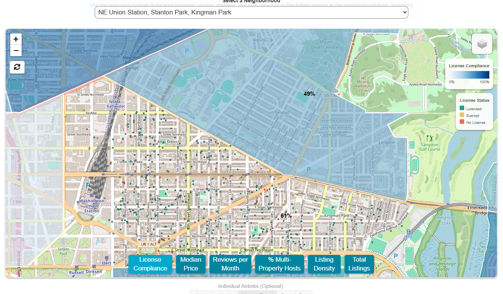  
_License status of Airbnb listings within a selected neighborhood._  

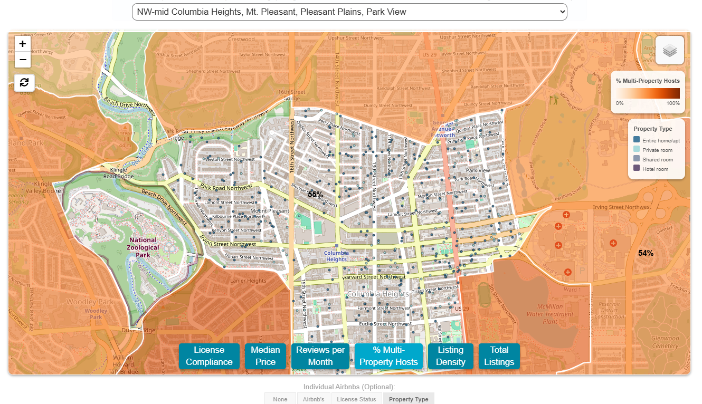  
_Distribution of Airbnb property types in a highlighted neighborhood._  

## References

Dataset provided by [Inside AirBnB](http://insideairbnb.com/about/).

Neighborhood population and housing unit data from [Census Reporter](https://censusreporter.org/).

Airbnb platform policy context:
- [Airbnb 2024 Spring Update](https://news.airbnb.com/airbnb-2024-spring-update/)
- [Airbnb Q1 2024 Shareholder Letter](https://s26.q4cdn.com/656283129/files/doc_financials/2024/q1/Airbnb_Q1-2024-Shareholder-Letter_Final-1.pdf)
- [Airbnb Q2 2024 Shareholder Letter](https://s26.q4cdn.com/656283129/files/doc_financials/2024/q2/Airbnb_Q2-2024-Shareholder-Letter_Final.pdf)

## License

[Creative Commons Attribution 4.0 International License](http://creativecommons.org/licenses/by/4.0/)

## Acknowledgements

- Thanks to Imen Najar for early insights and support.
- Thanks to Geronimo Perez for feedback and assistance during development.

## Author

Bryan Johns, February 2026  
[bryan.johns@informedwanderer.com](mailto:bryan.johns@informedwanderer.com) | [LinkedIn](https://www.linkedin.com/in/b-johns/) | [GitHub](https://github.com/johbry17) | [Portfolio](https://informedwanderer.com)  
— Fluent in Data. Fluent in Human.

